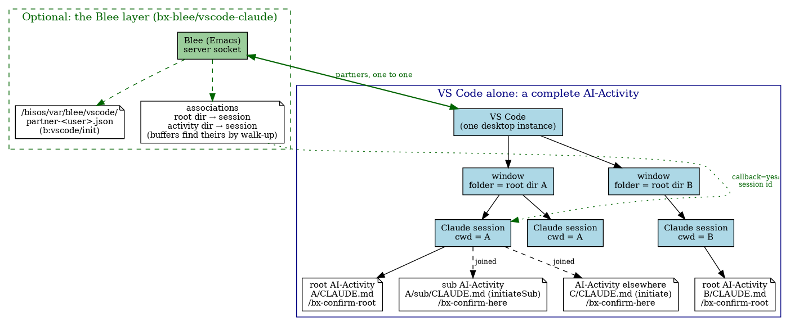
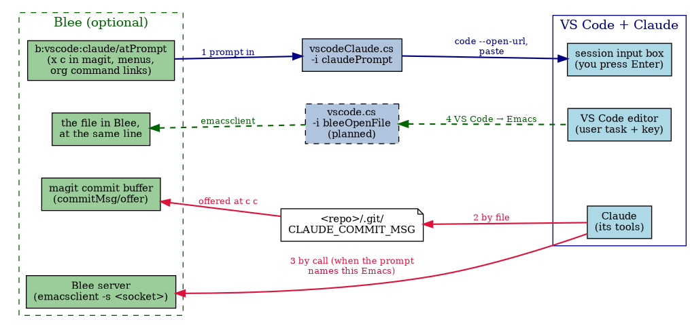
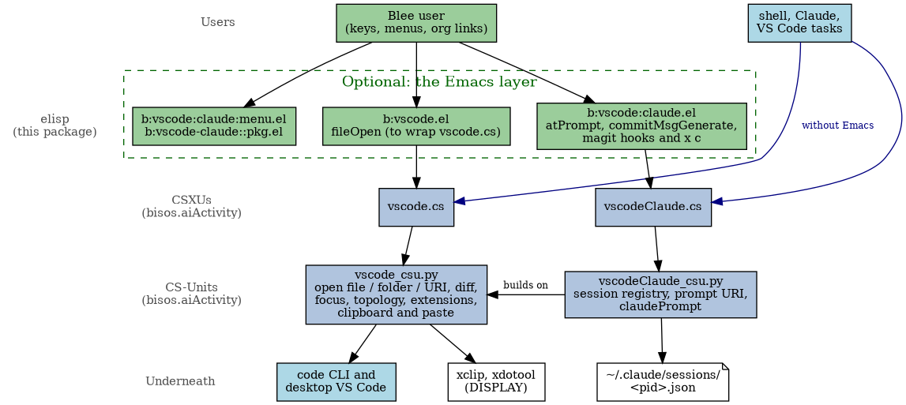

#+title: vscode-claude -- Blee Integration of Emacs and VS Code Claude, for AI-Activity
#+DATE: <2026-10-30 Fri>
#+AUTHOR: Mohsen BANAN
#+OPTIONS: toc:4

~Blee Panel Controls~: [[elisp:(show-all)][Show-All]] | [[elisp:(org-shifttab)][Overview]] | [[elisp:(progn (org-shifttab) (org-content))][Content]] | [[elisp:(delete-other-windows)][(1)]] | [[elisp:(progn (save-buffer) (kill-buffer))][S&Q]] | [[elisp:(save-buffer)][Save]]  | [[elisp:(kill-buffer)][Quit]]  | [[elisp:(bury-buffer)][Bury]]  \\
~See Also~: [[https://github.com/bisos-pip/aiActivity][bisos.aiActivity]] | [[file:./Emacs+VS-Code+Claude.org][Design paper (2026-10-27)]]

* Overview

This Blee (Emacs) package is for the integration of Emacs and VS Code Claude in the context of
AI-Activity.

*AI-Activity* is a structured mode of interacting with AI (Claude) that goes beyond the traditional
chatbot model: a durable, collaborative effort whose conventions, plan and state live in org files
under version control (=CLAUDE.md=, =AI-Activity.org=, =AI-WorkPlan.org=, =AI-DevStatus.org=), driven by
the =/bx-= commands and the skills. That model is described in
[[https://github.com/bisos-pip/aiActivity][bisos.aiActivity]] (see its
[[https://github.com/bisos-pip/aiActivity#why-ai-activity-not-chatbot][Why AI-Activity, Not Chatbot?]]).

*Pure VS Code Claude can be used with AI-Activity.* Everything an AI-Activity needs works inside VS
Code alone. *This package is the Blee layer that augments pure VS Code Claude* with integrated Emacs
capabilities. Blee is where the work is done: magit, panels, org files, COMEEGA source. The Claude
extension of VS Code is where the conversation happens: its panel renders diffs, tool calls,
sessions and permissions far better than a terminal. The Blee layer joins the two:

- *Emacs → Claude:* from any Blee context (a magit buffer, a panel, an org TODO) put a prompt ---
  normally a =/bx-= command with its arguments --- into a chosen Claude session. You press Enter.
- *Claude → Emacs:* Claude hands results back (a commit message for magit) and, when a prompt names
  your Emacs, reaches it with =emacsclient=.
- *VS Code → Emacs:* from the file in front of you in VS Code to the same line in Blee (planned).

*The Emacs layer is optional and does not interfere.* =CLAUDE.md=, the AI-WorkPlan, the =/bx-=
commands and the skills never require Emacs. Claude reaches Emacs only when a prompt names it, or
when you ask.

*As much as possible in Python, as little as possible in elisp.* The logic is in two small PyCS
command programs of bisos.aiActivity: =vscode.cs= (VS Code itself) and =vscodeClaude.cs= (its Claude
sessions). They are complete on their own --- a shell, Claude, or a VS Code task uses them directly.
The elisp here is a thin layer over them.

This README is both the design and the documentation. What is not built yet is marked /(planned)/,
with its TODO anchor in [[file:./AI-WorkPlan.org][AI-WorkPlan.org]].

* Table of Contents     :TOC:
- [[#overview][Overview]]
- [[#the-model][The Model]]
  - [[#emacs-vs-code-windows-sessions-ai-activities][Emacs, VS Code, Windows, Sessions, AI-Activities]]
  - [[#root-and-here][Root and Here]]
  - [[#the-partnership-and-the-associations][The Partnership and the Associations]]
- [[#the-channels][The Channels]]
- [[#the-layers][The Layers]]
  - [[#the-python-layer-vscodecs-and-vscodeclaudecs][The Python Layer: vscode.cs and vscodeClaude.cs]]
  - [[#the-elisp-layer][The elisp Layer]]
- [[#use][Use]]
  - [[#pure-vs-code][Pure VS Code]]
  - [[#from-blee-a-prompt-into-a-session][From Blee: a Prompt into a Session]]
  - [[#the-claude-magit-commit-cycle][The Claude-Magit Commit Cycle]]
  - [[#confirming-a-session-from-blee-planned][Confirming a Session from Blee (planned)]]
  - [[#from-vs-code-to-blee-planned][From VS Code to Blee (planned)]]
  - [[#org-command-links-planned][Org Command Links (planned)]]
- [[#deployment-topologies][Deployment Topologies]]
- [[#design-principles][Design Principles]]
- [[#vscode-claude-installation][vscode-claude Installation]]
  - [[#blee-installation][Blee Installation]]
  - [[#straight-installation][Straight Installation]]
- [[#files-of-this-package][Files of This Package]]
- [[#related][Related]]
- [[#status][Status]]

* The Model

** Emacs, VS Code, Windows, Sessions, AI-Activities

The hierarchy, top down:

| Level          | What it is                                     | How many                 |
|----------------+------------------------------------------------+--------------------------|
| Emacs (Blee)   | the running Blee server (its socket)           | one; optional            |
| VS Code        | the user's desktop VS Code instance            | one; partners with Emacs |
| window         | a VS Code window; its folder is a *root dir*     | many per VS Code         |
| Claude session | a conversation; its cwd is the window's folder | many per window (tabs)   |
| AI-Activity    | a directory with a =CLAUDE.md= (an activity dir) | a hierarchy per session  |

- *Emacs's socket* is =(expand-file-name server-name server-socket-dir)=: Blee knows its own.
- *One Emacs, one VS Code.* For one user there is one desktop VS Code per settings directory
  (=~/.config/Code=), and =code= (with =--open-url=) always reaches that running instance. A second,
  independent VS Code would need its own =--user-data-dir=, and every command would have to name it;
  one to one is simpler, and it is the design.
- *Several Claude sessions per window* share the window's folder as their working directory. A
  session registers in =~/.claude/sessions/<pid>.json= with its =sessionId= and =cwd=, which is what
  =vscodeClaude.cs -i claudeSessionsList= reads.

** Root and Here

A Claude session holds a hierarchy of AI-Activities. In bisos.aiActivity this is the
[[https://github.com/bisos-pip/aiActivity#ai-activity-topology-homogeneous-heterogeneous-hierarchical-lateral][AI-Activity Topology]]
(hierarchical and lateral; homogeneous and heterogeneous), and AI-WORKFLOW.org's "The AI-Activities
of a Session: Root and Here":

- *The root*: the session's working directory --- the VS Code window's folder --- with the top
  =CLAUDE.md=, created by =aiActivity.cs -i initiate= and confirmed by =/bx-confirm-root=.
- *Activities joined later* with =/bx-confirm-here <dir>=: an =initiateSub= sub of the root
  (homogeneous, or heterogeneous from another templates tree), or a separately initiated activity
  elsewhere (lateral).

An activity dir need not be a git repo; it is the directory that holds a =CLAUDE.md=.

=/bx-confirm-root= takes optional arguments, for Blee only. Without them it is the complete
confirmation and does nothing Emacs-related:

| Argument       | Effect                                                                   |
|----------------+--------------------------------------------------------------------------|
| =dir=<rootDir>=  | the root the sender means; a session rooted elsewhere is reported, stops |
| =emacs=<socket>= | Claude checks it can reach that Emacs (=emacs-pid=, read-only)             |
| =callback=yes=   | with =emacs==: Claude registers its session id with that Emacs             |

** The Partnership and the Associations

/(planned: =b:vscode/init=, the partner file, the associations, =b:vscode:claude/rootRegister=)/

- *=b:vscode/init= declares the partnership.* It writes the partner file
  =/bisos/var/blee/vscode/partner-<user>.json=: the socket path, the Emacs pid, =DISPLAY=, the time.
  On exit, =kill-emacs-hook= removes it, if it is still this Emacs's. Readers treat it as stale when
  the pid is dead or the socket is gone. A second Blee running =init= takes over: one to one.
- *The partner file is for the vscode layer's own tools*: =vscode.cs -i bleeOpenFile= (VS Code →
  Emacs) reads the socket from it. Claude does not go looking for it: a prompt names its Emacs
  explicitly (=emacs=<socket>=), so a stale partner file cannot pull a pure VS Code session into
  Emacs.
- *Associations: activity dir → session*, many to one, kept in Emacs:
  - =b:vscode:claude/confirmRoot= picks (or starts) the session of a root dir and sends it
    =/bx-confirm-root dir=<root> emacs=<socket> callback=yes=. Claude's callback,
    =b:vscode:claude/rootRegister=, records root dir → session id. The callback confirms that the
    prompt reached that session, and gives the id of a new conversation, which Emacs cannot know in
    advance.
  - =b:vscode:claude/confirmHere <dir>= sends =/bx-confirm-here <dir>= to the chosen session and
    records dir → session.
  - From a buffer, Emacs walks up from =default-directory= to the nearest associated activity dir
    and uses its session; with none, the latest session whose cwd covers the buffer.
  - One association per activity dir: the last confirmation wins. A session's id does not survive
    closing its tab: before use, a recorded session is checked against the running ones, and a dead
    one falls back to the latest in its directory, with a message.

* The Channels

| # | Channel              | Through                         | Status                 |
|---+----------------------+---------------------------------+------------------------|
| 1 | Prompt in            | =vscodeClaude.cs -i claudePrompt= | works                  |
| 2 | Results back by file | =<repo>/.git/CLAUDE_COMMIT_MSG=   | works                  |
| 3 | Results back by call | =emacsclient -s <socket>=         | works                  |
| 4 | VS Code → Emacs      | a VS Code task, =vscode.cs=       | planned, WorkPlan 10.9 |

- *1, prompt in.* The Claude extension's URI is
  =vscode://anthropic.claude-code/open?session=<sessionId>&prompt=<text>=, handed over by
  =code --open-url=. It opens the session, but a session already open ignores =prompt=, so
  =claudePrompt= puts the text on the clipboard (=xclip=) and pastes it (=xdotool=) into the focused
  input box. It never presses Enter: *you press Enter.* It needs the desktop VS Code's =DISPLAY=;
  without it, it refuses and names the =DISPLAY= the desktop runs on.
- *2, results by file.* =/bx-git-commit-msg= writes the message;
  =b:vscode:claude:magit:commitMsg/offer= (on =git-commit-setup-hook=) offers it when the commit
  buffer opens, and =…/markUsed= renames it to =CLAUDE_COMMIT_MSG.used= after the commit. Without
  Emacs: =git commit -t .git/CLAUDE_COMMIT_MSG=.
- *3, results by call*, only when the prompt names this Emacs or you ask. Read freely, change only
  with agreement: the =bs-blee-emacs-server= skill. Dblocks that only Blee can expand are
  regenerated through it.
- *4, VS Code → Emacs.* A user task in =~/.config/Code/User/tasks.json= runs
  =vscode.cs -i bleeOpenFile ${file} ${lineNumber} ${columnNumber}=, bound to a key in
  =keybindings.json=. =bleeOpenFile= takes the socket from the partner file, runs
  =emacsclient -n +LINE:COL FILE= and raises the Emacs frame. =vscodeBleeLinkSnippet= prints the
  task and key for you to paste (VS Code's JSON files take comments, so they are not merged
  automatically). Set =task.saveBeforeRun= to =always=; in Blee, =global-auto-revert-mode=.

* The Layers

** The Python Layer: vscode.cs and vscodeClaude.cs

Each layer has its own small CSXU, so that each gets its own examples menu and its elisp sits on its
own program: =b:vscode.el= over =vscode.cs=, =b:vscode:claude.el= over =vscodeClaude.cs=. The commands
are in the CS-Units =vscode_csu.py= and =vscodeClaude_csu.py=; =vscodeClaude_csu= builds on
=vscode_csu= (its URI, clipboard, paste and =DISPLAY= helpers). Both are in bisos.aiActivity; its
README, [[https://github.com/bisos-pip/aiActivity#prompt-a-vs-code-claude-session-vscodeclaudecs][Prompt a VS Code Claude Session]],
has the command tables.

- =vscode.cs=, VS Code itself:
  - inspect: =vscodeVersion=, =vscodeTopology=, =vscodeWorkspaces=, =vscodeExtensions=,
    =vscodeExtensionVersion=;
  - act: =vscodeFocus=, =vscodeOpenFile=, =vscodeOpenFolder=, =vscodeAddFolder=, =vscodeDiff=,
    =vscodeOpenUri=;
  - /(planned, WorkPlan 10.9)/ =bleeOpenFile=, =vscodeBleeLinkSnippet=.
- =vscodeClaude.cs=, its Claude sessions: =claudeSessionsList=, =claudeSessionsLatest=,
  =claudePromptUri=, =claudePrompt=.

** The elisp Layer

=…= is =b:vscode:claude=.

| Function                       | Key | Does                                          |
|--------------------------------+-----+-----------------------------------------------|
| =…/atPrompt <text> [session]=    |     | =vscodeClaude.cs -i claudePrompt=               |
| =…:aiActivity/commitMsgGenerate= | =x c= | =/bx-git-commit-msg <repo>= into the session    |
| =…:magit:commitMsg/offer=        |     | offers =CLAUDE_COMMIT_MSG= in the commit buffer |
| =…:magit:commitMsg/markUsed=     |     | renames it =.used= after the commit             |
| =…:magit/dispatch=               | =x=   | the transient; also in =magit-dispatch=         |
| =b:vscode/fileOpen=              |     | the file in VS Code (to use =vscodeOpenFile=)   |
| =b:vscode/init=                  |     | /(planned)/ the partnership                     |
| =…/confirmRoot=, =…/confirmHere=   |     | /(planned)/ the associations                    |
| =…/rootRegister=                 |     | /(planned)/ Claude's callback                   |

The menu (=b:vscode:claude:menu.el=) offers atPrompt and the commit message. Errors of the
programs (=EH_Problem= in their output) are shown in the =*vscodeClaude*= buffer.

* Use

** Pure VS Code

Nothing from this package is needed. Open the activity's root folder in VS Code, start a Claude
session, run =/bx-confirm-root=, and work. From a shell, =vscode.cs= and =vscodeClaude.cs= are there
too: =vscodeClaude.cs -i claudePrompt --cwd=. "/bx-status-read"= puts a prompt into the session of
this directory.

** From Blee: a Prompt into a Session

=M-x b:vscode:claude/atPrompt=, or from elisp:

#+begin_src emacs-lisp
(b:vscode:claude/atPrompt "/bx-status-read")                 ; the latest local session
(b:vscode:claude/atPrompt "/bx-status-read" "<sessionId>")   ; a given one (claudeSessionsList)
#+end_src

The VS Code window comes to the front with the prompt in the input box; read it, press Enter.

** The Claude-Magit Commit Cycle

1. In magit, stage what you want.
2. =x c=: =/bx-git-commit-msg <repo>= goes into the session; press Enter in VS Code.
3. Claude writes =.git/CLAUDE_COMMIT_MSG= (the 69/90 format) from the staged diff.
4. =c c=: the commit buffer offers Claude's message; accept, edit, =C-c C-c=.

Planned with it (Stage 8): =/bx-git-uncommitted-list= giving a list whose entries open magit in
Blee.

** Confirming a Session from Blee (planned)

=M-x b:vscode/init= once per Blee; then =b:vscode:claude/confirmRoot= in a buffer of the root, and
=b:vscode:claude/confirmHere= in a buffer of each activity joined. After that, =atPrompt= from any
buffer goes to the session of its activity.

** From VS Code to Blee (planned)

With the task and key of channel 4 installed: in VS Code, the key; Blee comes to the front at the
same file and line. Useful after Claude has edited a file, or after following a file link in
Claude's chat.

** Org Command Links (planned)

The =b:ai:vscodeClaude/workflow= dblock (=dblock-vscode-claude.el=) will carry a line of org links,
each sending a =/bx-= command through =atPrompt=: select a session, =bx-confirm-root=,
=bx-confirm-here=, =bx-status-read=, =bx-status-update=, =bx-git-commit-msg=, … (Stage 7).

* Deployment Topologies

| Topology                      | Prompt in                 | Status                       |
|-------------------------------+---------------------------+------------------------------|
| A. Desktop VS Code, Emacs's X | =code --open-url= and paste | works; the target            |
| B. Remote VS Code (a server)  | none: =--open-url= refused  | needs a bridge extension     |
| C. No VS Code                 | =claude -p "/bx-..."=       | self-contained commands only |

=vscode.cs -i vscodeTopology= says which one this shell is in. The details and the evidence are in
the [[file:./Emacs+VS-Code+Claude.org][design paper]].

* Design Principles

- *The Emacs layer is optional* and does not interfere with pure VS Code use.
- *You press Enter.* Emacs proposes prompts; nothing is submitted on your behalf.
- *Prompts are commands.* What Emacs sends is a =/bx-= command with explicit arguments, so the same
  request works typed by hand, sent from Emacs, or run headless.
- *Context travels as arguments, not hidden state.* A prompt names its directory, file, anchor or
  Emacs; commands verify from disk.
- *Claude in Emacs: read freely, change only with agreement* (=bs-blee-emacs-server=). The callback
  of =/bx-confirm-root= is a change asked for by the prompt.
- *Python first.* Logic in =vscode.cs= / =vscodeClaude.cs=; elisp wraps.
- *One place knows how to reach VS Code:* =vscode_csu= (the environment, =DISPLAY=, the desktop
  process). Blee does not call =code= directly.
- *COMEEGA throughout:* =b:elisp:defs/cl-defun= dblocks in elisp, =classHead= dblocks in Python.

* vscode-claude Installation

As with all Blee packages, Blee installation and straight installation are given. Blee
installation is verified; with straight installation you are on your own. Python side:
=pipx install bisos.aiActivity= (=vscode.cs=, =vscodeClaude.cs=); for channel 1, =xclip= and
=xdotool=.

** Blee Installation

Through =bnpa:vscode-claude.el=
([[https://github.com/bx-blee/env3/blob/main/plus/bnpa%3Avscode-claude.el][env3/plus]]), which
=plus-init.el= runs after =bnpa:aiplus=. Its =config|main= requires =b:vscode-claude::pkg= and, after
magit, runs =b:vscode:claude:magit|config=. Directly:

#+begin_src emacs-lisp
(b:pkg:straight|profiledInstall
   b:pkgsProfile:native
 '(vscode-claude :type git :host github :repo "bx-blee/vscode-claude"))
#+end_src

** Straight Installation

#+begin_src emacs-lisp
(use-package vscode-claude
  :straight (:host github :repo "bx-blee/vscode-claude"))
#+end_src

Not tested; it needs Blee's libraries (=blee-libs=).

* Files of This Package

| File                              | What                                             |
|-----------------------------------+--------------------------------------------------|
| =b:vscode-claude::pkg.el=           | the entry point: requires the modules, the group |
| =b:vscode.el=                       | the vscode layer, over =vscode.cs=                 |
| =b:vscode:claude.el=                | the Claude layer, over =vscodeClaude.cs=           |
| =b:vscode:claude:menu.el=           | the menu                                         |
| =dblock-vscode-claude.el=           | the =b:ai:vscodeClaude/workflow= dblock            |
| =images/vscodeClaude-graphviz.pcs=  | the figures of this README                       |
| =Emacs+VS-Code+Claude.org=          | the design paper of 2026-10-27                   |
| =AI-WorkPlan.org=, =AI-DevStatus.org= | the AI-Activity of this package                  |

* Related

- [[https://github.com/bisos-pip/aiActivity][bisos.aiActivity]]: the AI-Activity model and engine
  (=aiActivity.cs=), its workflow and =/bx-= commands, and =vscode.cs= / =vscodeClaude.cs=.
- AI-WORKFLOW.org (installed in every activity): the =/bx-= commands; "The AI-Activities of a
  Session: Root and Here".
- The skill =bs-blee-emacs-server=: Claude reaching the running Blee.
- [[https://github.com/bx-blee/aiplus][aiplus]]: gptel and aidermacs in Blee, the sibling package this
  one is modelled on.

* Status

As of 2026-10-30:
- Works: =atPrompt=, =x c= and the commit-message hooks over =vscodeClaude.cs=; =vscode.cs= and
  =vscodeClaude.cs= verified through their dispatchers; the package loads in a batch Emacs.
- Not yet verified in a restarted Blee: the =bnpa:vscode-claude.el= adoption.
- Planned: the partnership and associations, =/bx-confirm-root='s callback target (=rootRegister=),
  VS Code → Emacs (WorkPlan 10.9), the elisp over =vscode.cs= (10.2), the org command links
  (Stage 7).

# ###+BEGIN: blee:bxPanel:footerOrgParams
#+STARTUP: overview
#+STARTUP: lognotestate
#+STARTUP: inlineimages
#+SEQ_TODO: TODO WAITING DELEGATED | DONE DEFERRED CANCELLED
#+TAGS: @desk(d) @home(h) @work(w) @withInternet(i) @road(r) call(c) errand(e)
#+CATEGORY: N:vscode-claude-conceptAndDesign
# ###+END
# ###+BEGIN: blee:bxPanel:footerEmacsParams :primMode "org-mode"
# Local Variables:
# eval: (setq-local toc-org-max-depth 4)
# eval: (setq-local ~selectedSubject "noSubject")
# eval: (setq-local ~primaryMajorMode 'org-mode)
# eval: (setq-local ~blee:panelUpdater nil)
# eval: (setq-local ~blee:dblockEnabler nil)
# eval: (setq-local ~blee:dblockController "interactive")
# eval: (img-link-overlays)
# eval: (set-fill-column 105)
# eval: (blee:fill-column-indicator/enable)
# eval: (bx:load-file:ifOneExists "./panelActions.el")
# End:

# ###+END
