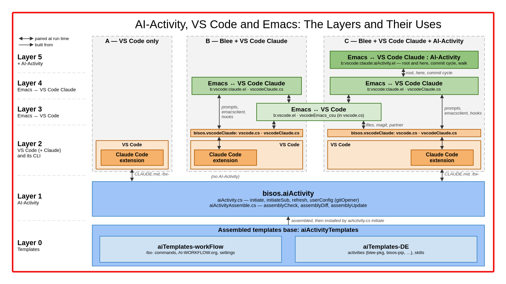

#+title: vscode-claude -- Blee Integration of Emacs and VS Code Claude, for AI-Activity
#+DATE: <2026-10-30 Fri>
#+AUTHOR: Mohsen BANAN
#+OPTIONS: toc:4

~Blee Panel Controls~: [[elisp:(show-all)][Show-All]] | [[elisp:(org-shifttab)][Overview]] | [[elisp:(progn (org-shifttab) (org-content))][Content]] | [[elisp:(delete-other-windows)][(1)]] | [[elisp:(progn (save-buffer) (kill-buffer))][S&Q]] | [[elisp:(save-buffer)][Save]]  | [[elisp:(kill-buffer)][Quit]]  | [[elisp:(bury-buffer)][Bury]]  \\
~See Also~: [[https://github.com/bisos-pip/aiActivity][bisos.aiActivity]] | [[file:./Emacs+VS-Code+Claude.org][Design paper (2026-10-27)]]

* Overview
This Blee (Emacs) package is for the integration of Emacs and VS Code Claude in the context of
AI-Activity.

*AI-Activity* is a structured mode of interacting with AI (Claude) that goes beyond the traditional
chatbot model: a durable, collaborative effort whose conventions, plan and state live in org files
under version control (=CLAUDE.md=, =AI-Activity.org=, =AI-WorkPlan.org=, =AI-DevStatus.org=), driven by
the =/bx-= commands and the skills. That model is described in
[[https://github.com/bisos-pip/aiActivity][bisos.aiActivity]] (see its
[[https://github.com/bisos-pip/aiActivity#why-ai-activity-not-chatbot][Why AI-Activity, Not Chatbot?]]).

*Pure VS Code Claude can be used with AI-Activity.* Everything an AI-Activity needs works inside VS
Code alone. *This package is the Blee layer that augments pure VS Code Claude* with integrated Emacs
capabilities. Blee is where the work is done: magit, panels, org files, COMEEGA source. The Claude
extension of VS Code is where the conversation happens: its panel renders diffs, tool calls,
sessions and permissions far better than a terminal. The Blee layer joins the two:
- *Emacs → Claude:* from any Blee context (a magit buffer, a panel, an org TODO) put a prompt ---
  normally a =/bx-= command with its arguments --- into a chosen Claude session. You press Enter,
  or ask Emacs to (submit).
- *Claude → Emacs:* Claude hands results back (a commit message for magit) and, when a prompt names
  your Emacs, reaches it with =emacsclient=.
- *VS Code → Emacs:* from the file in front of you in VS Code to the same line in Blee.
- *Claude events → Emacs:* Claude Code hooks tell Blee when Claude stops or waits for you.

*The Emacs layer is optional and does not interfere.* =CLAUDE.md=, the AI-WorkPlan, the =/bx-=
commands and the skills never require Emacs. Claude reaches Emacs only when a prompt names it, or
when you ask.

*Six layers, 0 to 5, each usable without those above* (see [[#the-six-layers][The Six Layers]]): the
AI-Activity templates and their executables, VS Code, Emacs <-> VS Code, Emacs <-> VS Code Claude, and
the last plus AI-Activity. A lower layer never names an upper one.

*As much as possible in Python, as little as possible in elisp.* The logic is in two small PyCS
command programs of [[https://github.com/bisos-pip/vscodeClaude][bisos.vscodeClaude]]: =vscode.cs=
(VS Code itself, and its partner Emacs) and =vscodeClaude.cs= (its Claude sessions). They are
complete on their own --- a shell, Claude, or a VS Code task uses them directly. The elisp here is
a thin layer over them.

This README is both the design and the documentation. What is not built yet is marked /(planned)/,
with its TODO anchor in [[file:./AI-WorkPlan.org][AI-WorkPlan.org]].

* Table of Contents     :TOC:
- [[#overview][Overview]]
- [[#the-six-layers][The Six Layers]]
  - [[#the-layers-and-their-uses][The Layers and Their Uses]]
  - [[#where-each-layer-lives][Where Each Layer Lives]]
  - [[#what-each-layer-holds][What Each Layer Holds]]
  - [[#a-lower-layer-never-names-an-upper-one][A Lower Layer Never Names an Upper One]]
  - [[#using-only-the-lower-layers][Using Only the Lower Layers]]
- [[#the-model][The Model]]
  - [[#emacs-vs-code-windows-sessions-ai-activities][Emacs, VS Code, Windows, Sessions, AI-Activities]]
  - [[#root-and-here][Root and Here]]
  - [[#the-partnership-and-the-associations][The Partnership and the Associations]]
- [[#the-channels][The Channels]]
- [[#commands-by-layer][Commands, by Layer]]
  - [[#python-vscodecs-and-vscodeclaudecs][Python: vscode.cs and vscodeClaude.cs]]
  - [[#elisp-layer-4-bvscodeclaude][elisp, Layer 4: b:vscode:claude]]
  - [[#elisp-layer-5-bvscodeclaudeaiactivity][elisp, Layer 5: b:vscode:claude:aiActivity]]
- [[#use][Use]]
  - [[#pure-vs-code][Pure VS Code]]
  - [[#from-blee-a-prompt-into-a-session][From Blee: a Prompt into a Session]]
  - [[#the-claude-magit-commit-cycle][The Claude-Magit Commit Cycle]]
  - [[#choosing-a-session][Choosing a Session]]
  - [[#confirming-a-session-from-blee][Confirming a Session from Blee]]
  - [[#committing-several-repos-the-commit-walk][Committing Several Repos: the Commit Walk]]
  - [[#from-vs-code-to-blee][From VS Code to Blee]]
  - [[#claude-code-hooks][Claude Code Hooks]]
  - [[#org-links-and-the-workflow-driver][Org Links and the Workflow Driver]]
- [[#deployment-topologies][Deployment Topologies]]
- [[#design-principles][Design Principles]]
- [[#vscode-claude-installation][vscode-claude Installation]]
  - [[#blee-installation][Blee Installation]]
  - [[#straight-installation][Straight Installation]]
- [[#files-of-this-package][Files of This Package]]
- [[#related][Related]]
- [[#status][Status]]

* The Six Layers

** The Layers and Their Uses

The figure puts all the layers, and the three ways of using them, on one page. Read it bottom up for
the layering, left to right for the uses.

- *The colours.* Blue is AI-Activity in BISOS: the templates (layer 0) and =bisos.aiActivity=
  (layer 1). Sand is VS Code with its Claude Code extension (layer 2): =/bin/code= running, not code
  of this package. Green, darker going up, is Blee (layers 3, 4 and 5): this package.
- *Layer 0, the templates.* =aiTemplates-workFlow= (the =/bx-= commands, =AI-WORKFLOW.org=) and
  =aiTemplates-DE= (the activities, the skills), assembled into a templates base that
  =aiActivity.cs -i initiate= installs into a project.
- *Layer 1, the executables.* =aiActivity.cs= and =aiActivityAssemble.cs=, in =bisos.aiActivity=.
- *Layer 2, the package.* =bisos.vscodeClaude=: the command-line interfaces to VS Code and its Claude
  extension. It also holds the Python halves of layers 3 and 4 (=vscodeEmacs_csu=, =vscodeClaude_csu=),
  as separate modules.
- *The arrows.* A two-headed arrow is a pairing at run time, labelled with what crosses it. The
  one-headed arrow means "built from".
- *The columns are the uses.* VS Code with Claude is drawn three times because it can be used in three
  ways:
  - *A, VS Code only.* Claude in VS Code reads the =CLAUDE.md= chain and runs the =/bx-= commands.
    No Emacs: a complete AI-Activity.
  - *B, Blee + VS Code Claude.* Blee prompts Claude (layer 4) and edits with VS Code (layer 3), in a
    project that is not an AI-Activity. There is no arrow down to layer 1.
  - *C, Blee + VS Code Claude + AI-Activity.* All of it. Layer 5 adds, from Blee, root and here, the
    commit cycle and the commit walk.
- *Layer 2 pairs with both 3 and 4.* In B and C, both reach VS Code through its command-line
  interface, =bisos.vscodeClaude= (=vscode.cs=, =vscodeClaude.cs=), the narrow box on top of VS Code:
  layer 3 for VS Code itself (files, magit, the partner file), layer 4 for its Claude extension
  (prompts in, =emacsclient= back, the hooks). Layer 3 is one box shared by B and C: one Emacs
  partners with one VS Code. Column A needs no such interface: Claude runs inside VS Code.

The source is =images/LibreOffice/blee-aiActivity-layers.odg= (LibreOffice Draw).

** Where Each Layer Lives

Top down, as in the figure:

| # | GitHub                                            | PyPI                                        |
|---+---------------------------------------------------+---------------------------------------------|
| 5 | https://github.com/bx-blee/vscode-claude          | ---                                         |
| 4 | https://github.com/bx-blee/vscode-claude          | ---                                         |
| 3 | https://github.com/bx-blee/vscode-claude          | ---                                         |
| 2 | https://github.com/bisos-pip/vscodeClaude         | https://pypi.org/project/bisos.vscodeClaude |
| 1 | https://github.com/bisos-pip/aiActivity           | https://pypi.org/project/bisos.aiActivity   |
| 0 | https://github.com/bxObjects/aiActivityTemplates  | ---                                         |
| 0 | https://github.com/bxObjects/aiTemplates-DE       | ---                                         |
| 0 | https://github.com/bxObjects/aiTemplates-workFlow | ---                                         |

- *3, 4 and 5* are this package, one repo of elisp (=b:vscode.el=, =b:vscode:claude.el=,
  =b:vscode:claude:aiActivity.el=). Not packaged yet: =package.recipe= is ready for MELPA.
- *2* is =bisos.vscodeClaude= (/planned/ on PyPI: not yet published). It also holds the Python halves
  of layers 3 and 4 (=vscodeEmacs_csu=, =vscodeClaude_csu=).
- *1* is =bisos.aiActivity=: =aiActivity.cs= and =aiActivityAssemble.cs=.
- *0* is three repos and no package: =aiTemplates-workFlow= (the workflow) and =aiTemplates-DE= (the
  ecosystem's activities and skills) are the inputs; =aiActivityTemplates= is the base assembled from
  them, the one =aiActivity.cs -i initiate= installs from (on BISOS,
  =/bisos/apps/defaults/ai-templates=).

** What Each Layer Holds

| # | Layer                    | Where                                    | Alone, it serves           |
|---+--------------------------+------------------------------------------+----------------------------|
| 5 | 4 + AI-Activity          | =b:vscode:claude:aiActivity.el=          | all of this README         |
| 4 | Emacs <-> VS Code Claude | =vscodeClaude.cs=, =b:vscode:claude.el=  | Claude from Blee, no /bx-  |
| 3 | Emacs <-> VS Code        | =vscodeEmacs_csu=, =b:vscode.el=         | editing in both, no Claude |
| 2 | VS Code                  | =vscode.cs= (=vscode_csu=)               | VS Code from a shell       |
| 1 | AI-Activity executables  | =aiActivity.cs=, =aiActivityAssemble.cs= | with 0: any AI-Activity    |
| 0 | AI-Activity templates    | =/bx-= commands, AI-WORKFLOW, skills     | what Claude reads          |

- *5, + AI-Activity.* What Blee does because the work is an AI-Activity: root and here from Blee,
  the commit cycle (=x c=, =x x=, the message offer, magit raised on Claude's Stop), the commit
  walk, the =/bx-= menus.
- *4, Emacs <-> VS Code Claude.* Prompts into a session (and submitting them), choosing the session,
  sends with =@file:line= context, the Claude Code hooks. It knows nothing of AI-Activity: it names
  no =/bx-= command and no =CLAUDE.md=.
- *3, Emacs <-> VS Code.* The partner file (one Emacs per VS Code), VS Code to Emacs
  (=bleeOpenFile=, =bleeMagit=), Emacs to VS Code (=b:vscode/fileOpen=). No Claude.
- *2, VS Code.* Opening files, folders, diffs and URIs in the local VS Code, its topology and
  extensions. No Emacs, no Claude.
- *1, the AI-Activity executables.* =aiActivity.cs= installs a templates base into a project
  (=initiate=, =initiateSub=, =refresh=) and holds the user's settings (=gitOpener=);
  =aiActivityAssemble.cs= assembles a base from its inputs. No editor, no Claude.
- *0, the AI-Activity templates.* What a session reads and runs: a session anchored in a root dir,
  holding a hierarchy of AI-Activities (hierarchical or lateral, homogeneous or heterogeneous;
  [[#root-and-here][Root and Here]]), the =CLAUDE.md= chain, the WorkPlan, the =/bx-= commands, the
  skills. Content, not code, and neutral to the inference engine; in practice it runs in Claude, in a
  terminal or in VS Code. It needs no editor.

** A Lower Layer Never Names an Upper One

Where a lower layer needs something only an upper one knows, it declares a hook, a function
variable, a setting or an argument, and the upper layer supplies it:

| The lower layer asks for                           | The upper layer supplies                         |
|----------------------------------------------------+--------------------------------------------------|
| 4: =b:vscode:claude:baseDir-function= (a git repo) | 5: the AI-Activity dir (the nearest =CLAUDE.md=) |
| 4: =b:vscode:claude:event-hook=                    | 5: the commit-message-ready handler              |
| 4: the =b:vscode:claude/dispatch= transient        | 5: its =a= entry, the =/bx-= menu                |
| 0: =/bx-confirm-root register=<function>=          | 5: =b:vscode:claude:aiActivity/rootRegister=     |
| 0: =/bx-git-commit-walk walk=<function>=           | 5: =b:vscode:claude:aiActivity:magit/walk=       |
| 1: the =gitOpener= setting (=aiActivity.cs=)       | 3: =vscode.cs -i bleeMagit=                      |

[[file:./images/vscodeClaudeLayers.png]]

Each layer loads and works with only the layers below it: the batch tests load layer 4 alone and
check that it defines nothing of layer 5.

** Using Only the Lower Layers

- *Layers 0 and 1 alone*: open the activity's root folder in VS Code (or run =claude= there), start a
  session, =/bx-confirm-root=, work. Nothing from this package.
- *Up to layer 2*: =vscode.cs= from a shell or a script --- open a file at a line, a diff, a URI.
- *Up to layer 3*: Blee and VS Code editing the same files, each opening them in the other; no
  Claude involved.
- *Up to layer 4*: Claude in VS Code driven from Blee --- prompts, regions, errors at point, a
  chosen session, the hook events --- in a project that is not an AI-Activity. Load
  =b:vscode:claude= without =b:vscode:claude:aiActivity=.
- *All six*: the package as installed (=b:vscode-claude::pkg= loads both elisp layers).

* The Model

** Emacs, VS Code, Windows, Sessions, AI-Activities

[[file:./images/vscodeClaudeHierarchy.png]]

The hierarchy, top down:

| Level          | What it is                                       | How many                 |
|----------------+--------------------------------------------------+--------------------------|
| Emacs (Blee)   | the running Blee server (its socket)             | one; optional            |
| VS Code        | the user's desktop VS Code instance              | one; partners with Emacs |
| window         | a VS Code window; its folder is a *root dir*     | many per VS Code         |
| Claude session | a conversation; its cwd is the window's folder   | many per window (tabs)   |
| AI-Activity    | a directory with a =CLAUDE.md= (an activity dir) | a hierarchy per session  |

- *Emacs's socket* is =(expand-file-name server-name server-socket-dir)=: Blee knows its own.
- *One Emacs, one VS Code.* For one user there is one desktop VS Code per settings directory
  (=~/.config/Code=), and =code= (with =--open-url=) always reaches that running instance. A second,
  independent VS Code would need its own =--user-data-dir=, and every command would have to name it;
  one to one is simpler, and it is the design.
- *Several Claude sessions per window* share the window's folder as their working directory. A
  session registers in =~/.claude/sessions/<pid>.json= with its =sessionId= and =cwd=, which is what
  =vscodeClaude.cs -i claudeSessionsList= reads.

** Root and Here

A Claude session holds a hierarchy of AI-Activities. In bisos.aiActivity this is the
[[https://github.com/bisos-pip/aiActivity#ai-activity-topology-homogeneous-heterogeneous-hierarchical-lateral][AI-Activity Topology]]
(hierarchical and lateral; homogeneous and heterogeneous), and AI-WORKFLOW.org's "The AI-Activities
of a Session: Root and Here":

- *The root*: the session's working directory --- the VS Code window's folder --- with the top
  =CLAUDE.md=, created by =aiActivity.cs -i initiate= and confirmed by =/bx-confirm-root=.
- *Activities joined later* with =/bx-confirm-here <dir>=: an =initiateSub= sub of the root
  (homogeneous, or heterogeneous from another templates tree), or a separately initiated activity
  elsewhere (lateral).

An activity dir need not be a git repo; it is the directory that holds a =CLAUDE.md=.

=/bx-confirm-root= takes optional arguments, for an editor. Without them it is the complete
confirmation and does nothing editor-related:

| Argument         | Effect                                                                     |
|------------------+----------------------------------------------------------------------------|
| =dir=<rootDir>=  | the root the sender means; a session rooted elsewhere is reported, stops   |
| =emacs=<socket>= | Claude checks it can reach that Emacs (=emacs-pid=, read-only)             |
| =register=<fn>=  | with =emacs==: Claude calls that function with the root and its session id |

** The Partnership and the Associations

- *=b:vscode/init= declares the partnership.* It writes the partner file
  =/bisos/var/blee/vscode/partner-<user>.json=: the socket path, the Emacs pid, =DISPLAY=, the time.
  On exit, =kill-emacs-hook= removes it, if it is still this Emacs's. Readers treat it as stale when
  the pid is dead or the socket is gone. A second Blee running =init= takes over: one to one.
- *The partner file is for layer 3's own tools*: =vscode.cs -i bleeOpenFile= and =bleeMagit= (VS
  Code → Emacs) read the socket from it. Claude does not go looking for it: a prompt names its Emacs
  explicitly (=emacs=<socket>=), so a stale partner file cannot pull a pure VS Code session into
  Emacs.
- *Associations: base dir → session*, many to one, kept in Emacs (layer 4). A buffer's base dir is
  its git repo; with layer 5, its AI-Activity dir (the nearest =CLAUDE.md= above).
  - Layer 4 fills them by choice: =b:vscode:claude/sessionSelect=
    ([[#choosing-a-session][Choosing a Session]]).
  - Layer 5 fills them by confirmation: =b:vscode:claude:aiActivity/confirmRoot= picks the session of
    a root dir (asking when several share it) and sends it
    =/bx-confirm-root dir=<root> emacs=<socket> register=b:vscode:claude:aiActivity/rootRegister=;
    Claude calls that function back with its session id, which confirms that the prompt reached
    that session and gives the id of a new conversation. =b:vscode:claude:aiActivity/confirmHere=
    sends =/bx-confirm-here <dir>= and records dir → session.
  - From a buffer, the session is: a one-shot choice (a new conversation), else this buffer's own
    choice, else the association nearest above (walk-up), else the session whose cwd covers the
    buffer, else the latest local one.
  - One association per dir: the last choice or confirmation wins. A session's id does not survive
    closing its tab: before use, a recorded session is checked against the running ones, and a dead
    one is dropped, with a message.

* The Channels

[[file:./images/vscodeClaudeChannels.png]]

| # | Channel              | Through                              | Status |
|---+----------------------+--------------------------------------+--------|
| 1 | Prompt in            | =vscodeClaude.cs -i claudePrompt=    | works  |
| 2 | Results back by file | =<repo>/.git/CLAUDE_COMMIT_MSG=      | works  |
| 3 | Results back by call | =emacsclient -s <socket>=            | works  |
| 4 | VS Code → Emacs      | a VS Code task, =vscode.cs=          | works  |
| 5 | Claude events → Blee | Claude Code hooks, =vscodeClaude.cs= | works  |

- *1, prompt in.* The Claude extension's URI is
  =vscode://anthropic.claude-code/open?session=<sessionId>&prompt=<text>=, handed over by
  =code --open-url=. It opens the session, but a session already open ignores =prompt=, so
  =claudePrompt= puts the text on the clipboard (=xclip=) and pastes it (=xdotool=) into the focused
  input box. *You press Enter* --- unless =--submit=yes= (from Blee: submit), which presses it with
  =xdotool= once the prompt is in. It needs the desktop VS Code's =DISPLAY=;
  without it, it refuses and names the =DISPLAY= the desktop runs on.
- *2, results by file.* =/bx-git-commit-msg= writes the message;
  =b:vscode:claude:aiActivity:magit:commitMsg/offer= (on =git-commit-setup-hook=) offers it when the
  commit buffer opens, and =…/markUsed= renames it to =CLAUDE_COMMIT_MSG.used= after the commit
  (layer 5). Without Emacs: =git commit -t .git/CLAUDE_COMMIT_MSG=.
- *3, results by call*, only when the prompt names this Emacs or you ask. Read freely, change only
  with agreement: the =bs-blee-emacs-server= skill. Dblocks that only Blee can expand are
  regenerated through it.
- *4, VS Code → Emacs.* A user task in =~/.config/Code/User/tasks.json= runs
  =vscode.cs -i bleeOpenFile ${file} ${lineNumber} ${columnNumber}=, bound to a key in
  =keybindings.json=. =bleeOpenFile= takes the socket from the partner file, runs
  =emacsclient -n +LINE:COL FILE= and raises the Emacs frame. =vscodeBleeLinkInstall= merges the
  task, its key (=ctrl+k ctrl+e=) and =task.saveBeforeRun= into VS Code's user files
  (=vscodeBleeLinkSnippet= prints them to paste instead). In Blee, =global-auto-revert-mode=.
- *5, Claude events → Blee.* Channel 3 started by Claude Code itself rather than by Claude's choice.
  Claude Code runs /hooks/ --- commands configured in =settings.json= --- on events of a session,
  in VS Code sessions as in terminal ones; each gets the event as JSON on stdin (=session_id=,
  =cwd=, =hook_event_name=, ...). The hook command is =vscodeClaude.cs -i hookToEmacs <event>=:
  - It does nothing, quietly and at once, unless the partner file names a live Emacs: *a pure VS
    Code session is not affected.* It never blocks or fails the session (short timeout, exit 0).
  - Otherwise it hands the event to =b:vscode:claude/hookHandle= by =emacsclient=, which runs
    =b:vscode:claude:event-hook= (layer 4; the model is claude-code.el's =claude-code-handle-hook=
    and =claude-code-event-hook=).
  - Handlers: /Notification/ (Claude waits for you) shows a message in Blee (layer 4); /Stop/ after
    =/bx-git-commit-msg= raises magit for that repo (layer 5).
  - Installed in the user's =~/.claude/settings.json=, not in the shared templates;
    =vscodeClaude.cs -i hooksInstall= merges the entry (=hooksSnippet= prints it).

* Commands, by Layer

** Python: vscode.cs and vscodeClaude.cs

In [[https://github.com/bisos-pip/vscodeClaude][bisos.vscodeClaude]], whose README has the command
tables. =vscode.cs= has two CS-Units, one per layer; =vscodeClaude.cs= builds on both.

- Layer 2, =vscode.cs= (=vscode_csu.py=), VS Code itself:
  - inspect: =vscodeVersion=, =vscodeTopology=, =vscodeWorkspaces=, =vscodeExtensions=,
    =vscodeExtensionVersion=;
  - act: =vscodeFocus=, =vscodeOpenFile=, =vscodeOpenFolder=, =vscodeAddFolder=, =vscodeDiff=,
    =vscodeOpenUri=.
- Layer 3, =vscode.cs= (=vscodeEmacs_csu.py=), its partner Emacs: =vscodePartner=, =bleeOpenFile=,
  =bleeMagit= (the =gitOpener= of =/bx-git-commit-walk=), =vscodeBleeLink{Snippet,Check,Install}=.
- Layer 4, =vscodeClaude.cs= (=vscodeClaude_csu.py=), its Claude sessions: =claudeSessionsList=,
  =claudeSessionsLatest=, =claudePromptUri=, =claudePrompt= (=--submit=); the hooks: =hookToEmacs=,
  =hooks{Snippet,Check,Install}=.

** elisp, Layer 4: b:vscode:claude

=…= is =b:vscode:claude=. A =C-u= prefix flips submit for one send; on =sessionSelect= and
=sessionForget=, it means this buffer only. Layer 3's =b:vscode/…= is in the same menu.

| Function                           | Key   | Does                                              |
|------------------------------------+-------+---------------------------------------------------|
| =…/dispatch=                       |       | the transient; its title shows the target session |
| =…/atPrompt=                       | =s=   | a prompt into this buffer's session               |
| =…/sendWithContext=                | =x=   | a prompt, with =@file:line= of point or region    |
| =…/sendRegion=, =…/sendBufferFile= | =r o= | the region, the file                              |
| =…/fixErrorAtPoint=                | =e=   | flymake / flycheck error at point, to fix         |
| =…/sessionSelect=                  | =c=   | choose the session for this base dir              |
| =…/sessionForget=                  | =F=   | back to the automatic choice                      |
| =…/associationsShow=               | =l=   | the recorded base dirs and sessions               |
| =…/submitToggle=                   | =S=   | prompts submitted (Enter pressed) or not          |
| =…/hookHandle=                     |       | receives Claude Code hook events                  |
| =b:vscode/fileOpen=                | =f=   | this file in VS Code, at point (layer 3)          |
| =b:vscode/init=, =…/partnerShow=   | =p P= | this Emacs is the partner; show it (layer 3)      |

** elisp, Layer 5: b:vscode:claude:aiActivity

=…= is =b:vscode:claude:aiActivity=. Its menu is =a= in layer 4's.

| Function                         | Key   | Does                                                   |
|----------------------------------+-------+--------------------------------------------------------|
| =…/dispatch=                     | =a=   | the =/bx-= commands of this buffer's session           |
| =…/confirmRoot=, =…/confirmHere= | =r h= | confirm the session's activities; associate            |
| =…/rootRegister=                 |       | named in =/bx-confirm-root register==; Claude calls it |
| =…/bxSend=                       |       | send =/bx-<name>=                                      |
| =…/todoDo=, =…/todoDone=         | =t T= | =/bx-todo-do=, =/bx-todo-done=; ask the anchor         |
| =…:link/follow=                  |       | follows an =aiActivity:= link                          |
| =…/activityDir=                  |       | the base dir it gives layer 4                          |

In magit, =x= is =…:magit/dispatch=:

| Key   | Function                    | Does                                                |
|-------+-----------------------------+-----------------------------------------------------|
| =x c= | =…/commitMsgGenerate=       | =/bx-git-commit-msg <repo>=; you press Enter        |
| =x x= | =…/commitMsgGenerateSubmit= | the same, submitted                                 |
| =x w= | =…:magit/walkStart=         | ask Claude for a commit walk of the session's repos |
| =x n= | =…:magit/walkNext=          | the walk's next repo                                |
| =x d= | =b:vscode:claude/dispatch=  | the layer-4 transient                               |

=…:magit:commitMsg/offer= and =…/markUsed= are the commit-buffer hooks of channel 2;
=…:hook/commitMsgReady= is the Stop handler. The menu (=b:vscode:claude:menu.el=) offers both
layers: Prompt, Magit, Session, VS Code. Errors of the programs (=EH_Problem= in their output) are
shown in the =*vscodeClaude*= and =*vscode*= buffers.

* Use

** Pure VS Code

Nothing from this package is needed. Open the activity's root folder in VS Code, start a Claude
session, run =/bx-confirm-root=, and work. From a shell, =vscode.cs= and =vscodeClaude.cs= are there
too: =vscodeClaude.cs -i claudePrompt --cwd=. "/bx-status-read"= puts a prompt into the session of
this directory.

** From Blee: a Prompt into a Session

=M-x b:vscode:claude/atPrompt=, or from elisp:

#+begin_src emacs-lisp
(b:vscode:claude/atPrompt "/bx-status-read")                 ; this buffer's session
(b:vscode:claude/atPrompt "/bx-status-read" "<sessionId>")   ; a given one (claudeSessionsList)
(b:vscode:claude/atPrompt "/bx-status-read" nil t)           ; submitted
#+end_src

The VS Code window comes to the front with the prompt in the input box; read it, press Enter. Which
session: [[#choosing-a-session][Choosing a Session]].

** The Claude-Magit Commit Cycle

1. In magit, stage what you want.
2. =x c=: =/bx-git-commit-msg <repo>= goes into the session; press Enter in VS Code. Or =x x=:
   submitted.
3. Claude writes =.git/CLAUDE_COMMIT_MSG= (the 69/90 format) from the staged diff.
4. With the hooks installed, Claude's Stop raises Blee at that repo's magit status.
5. =c c=: the commit buffer offers Claude's message; accept, edit, =C-c C-c=.

** Choosing a Session

By default a buffer's prompts go to the session whose folder holds the buffer (the newest, when
several do), else to the latest local one. To choose (layer 4):

- =c= in =b:vscode:claude/dispatch= (=b:vscode:claude/sessionSelect=): a list of the running
  sessions --- name, status, last active, folder, id --- and "(a new conversation)". The choice
  holds for every buffer under this base dir; with =C-u=, for this buffer only.
- "A new conversation" applies to the next prompt only; afterwards the new session is found by its
  folder.
- =F= (=b:vscode:claude/sessionForget=) goes back to the automatic choice; =l= lists the choices.
- The transient's title shows where a prompt from this buffer would go, before you send it.

** Confirming a Session from Blee

=b:vscode:claude:aiActivity/confirmRoot= (=a r=) in a buffer of the root (the VS Code window's
folder), and =b:vscode:claude:aiActivity/confirmHere= (=a h=) in a buffer of each activity joined.
When several sessions share the root's folder, it asks which. After that, prompts from any buffer
of an activity go to its session. The associations live in this Emacs only.

** Committing Several Repos: the Commit Walk

At the end of a session, =/bx-git-commit-walk= takes you through the repos the session changed,
in commit order. Either way, in each repo: stage, =x x=, =c c=, =C-c C-c=; each message ends with
the next repo's path.

- *From Blee*: =x w= in magit asks this repo's session for a walk; Claude hands Blee the list, and
  =x n= opens the next repo (asking when the current one still has changes).
- *From VS Code*: type =/bx-git-commit-walk=; with the setting below, Claude opens each repo's magit
  in Blee (=vscode.cs -i bleeMagit=) and you say "next".
  : aiActivity.cs -i userConfig_set --parName=gitOpener --parValue='vscode.cs -i bleeMagit'

** From VS Code to Blee

Once: =M-x b:vscode/init= in Blee (the partner file), and =vscode.cs -i vscodeBleeLinkInstall=,
which merges a task and its key into VS Code's user files (=vscodeBleeLinkCheck= says what is there;
=--key= picks another key). Then, in VS Code, =ctrl+k ctrl+e= (a chord: Ctrl+K, then Ctrl+E): Blee
comes to the front at the same file and line. Useful after Claude has edited a
file, or after following a file link in Claude's chat. =b:vscode/init= is run by hand, not at
startup, so that a second Blee does not take the partner role unasked.

** Claude Code Hooks

Once: =M-x b:vscode/init= in Blee, and =vscodeClaude.cs -i hooksInstall=, which merges the
="hooks"= entry into =~/.claude/settings.json= (=hooksCheck= says what is there). Then every Claude
session started afterwards (VS Code or terminal) runs =hookToEmacs= on Stop and Notification. With no
live partner it does nothing.
=b:vscode:claude:event-hook= takes your own handlers: each gets a plist (=:type=, =:session=, =:cwd=,
=:data=).

** Org Links and the Workflow Driver

An =aiActivity:= link sends a =/bx-= command to the session of the buffer's AI-Activity:
=[[aiActivity:status-read][Status]]= sends =/bx-status-read=, =[[aiActivity:todo-do 7.1]]= sends
=/bx-todo-do 7.1=. =C-c C-o= (or a click) pastes it and you press Enter; =C-u C-c C-o= submits it.
They work anywhere in an org buffer, e.g. inside a TODO: "then [[aiActivity:status-update]]". Without
Blee they show as text that names the command.

Some names do more than a plain send: =confirm-root= and =confirm-here= go through =confirmRoot= and
=confirmHere= (the registration and the activity dir), =git-commit-msg= through =x c= (this repo, the
request recorded for the Stop hook), =git-commit-walk= through =x w=, and =todo-do= / =todo-done=
without an anchor ask which open TODO of the activity's WorkPlan.

The =b:ai:workflow/driver= dblock, near the top of every =AI-WorkPlan.org=, is a panel of them;
=Update Buf Dblocks= in Blee fills it. Each label is the command it sends; the links after =|S|=
(bold, =S== in their path) are submitted. A control line comes first, unless =:controls nil=:

#+begin_example
--  Back read/wr | Show-All  Overview  Content | (1) | S&Q Save Quit Bury Magit
* AI Workflow Driver :: /bx- commands into this activity's VS Code Claude session
  Session :: select-session | confirm-root | confirm-here  |S|  confirm-root | confirm-here
  Read    :: status-read | archive-read | ai-outputs  |S|  status-read | archive-read | ai-outputs
  Work    :: todo-do | todo-done  |S|  todo-do | todo-done
  Record  :: status-update | archive-update  |S|  status-update | archive-update
  Git     :: git-commit-msg | git-commit-walk  |S|  git-commit-msg
  Close   :: git-uncommitted-list | session-verify  |S|  git-uncommitted-list | session-verify
#+end_example

The seed WorkPlan (aiTemplates-workFlow) carries the dblock empty: layer 0 declares the slot, layer 5
fills it. The earlier names =b:ai:vscodeClaude/workflow= and =…/workflowDriver= still work. The same
commands are in the transient (=b:vscode:claude/dispatch=, =a=), with =t= / =T= for the TODOs.

* Deployment Topologies

| Topology                      | Prompt in                   | Status                       |
|-------------------------------+-----------------------------+------------------------------|
| A. Desktop VS Code, Emacs's X | =code --open-url= and paste | works; the target            |
| B. Remote VS Code (a server)  | none: =--open-url= refused  | needs a bridge extension     |
| C. No VS Code                 | =claude -p "/bx-..."=       | self-contained commands only |

=vscode.cs -i vscodeTopology= says which one this shell is in. The details and the evidence are in
the [[file:./Emacs+VS-Code+Claude.org][design paper]].

* Design Principles

- *The Emacs layer is optional* and does not interfere with pure VS Code use.
- *You press Enter*, unless you asked Emacs to: submit is an explicit option (=x x=, =C-u=, =S=).
- *Prompts are commands.* What Emacs sends is a =/bx-= command with explicit arguments, so the same
  request works typed by hand, sent from Emacs, or run headless.
- *Context travels as arguments, not hidden state.* A prompt names its directory, file, anchor or
  Emacs; commands verify from disk.
- *Six layers, 0 to 5, each usable without those above*; a lower layer never names an upper one.
- *Claude in Emacs: read freely, change only with agreement* (=bs-blee-emacs-server=). The
  =register== of =/bx-confirm-root= and the opening done by =/bx-git-commit-walk= are changes asked
  for by the prompt.
- *Python first.* Logic in =vscode.cs= / =vscodeClaude.cs=; elisp wraps.
- *One place knows how to reach VS Code:* =vscode_csu= (the environment, =DISPLAY=, the desktop
  process). Blee does not call =code= directly.
- *COMEEGA throughout:* =b:elisp:defs/cl-defun= dblocks in elisp, =classHead= dblocks in Python.

* vscode-claude Installation

As with all Blee packages, Blee installation and straight installation are given. Blee
installation is verified; with straight installation you are on your own. Python side:
=pipx install bisos.vscodeClaude= (=vscode.cs=, =vscodeClaude.cs=, =vscode-sbom.pcs=); for channel 1,
=xclip= and =xdotool=.

** Blee Installation

Through =bnpa:vscode-claude.el=
([[https://github.com/bx-blee/env3/blob/main/plus/bnpa%3Avscode-claude.el][env3/plus]]), which
=plus-init.el= runs after =bnpa:aiplus=. Its =config|main= requires =b:vscode-claude::pkg= and, after
magit, runs =b:vscode:claude:magit|config= (now an alias of layer 5's
=b:vscode:claude:aiActivity:magit|config=). Directly:

#+begin_src emacs-lisp
(b:pkg:straight|profiledInstall
   b:pkgsProfile:native
 '(vscode-claude :type git :host github :repo "bx-blee/vscode-claude"))
#+end_src

** Straight Installation

#+begin_src emacs-lisp
(use-package vscode-claude
  :straight (:host github :repo "bx-blee/vscode-claude"))
#+end_src

Not tested; it needs Blee's libraries (=blee-libs=).

* Files of This Package

| File                                            | What                                             |
|-------------------------------------------------+--------------------------------------------------|
| =b:vscode-claude::pkg.el=                       | the entry point: requires the modules, the group |
| =b:vscode.el=                                   | layer 3's elisp, over =vscode.cs=                |
| =b:vscode:claude.el=                            | layer 4, over =vscodeClaude.cs=                  |
| =b:vscode:claude:aiActivity.el=                 | layer 5, over layer 4                            |
| =b:vscode:claude:menu.el=                       | the menu, both elisp layers                      |
| =dblock-vscode-claude.el=                       | the =b:ai:workflow/driver= dblock                |
| =images/vscodeClaude-graphviz.pcs=              | the generated figures of this README             |
| =images/LibreOffice/blee-aiActivity-layers.odg= | the layers and their uses (Draw)                 |
| =Emacs+VS-Code+Claude.org=                      | the design paper of 2026-10-27                   |
| =AI-WorkPlan.org=, =AI-DevStatus.org=           | the AI-Activity of this package                  |
| =NextSteps.org=                                 | a critique and suggested next steps (2026-11-01) |

* Related

- [[https://github.com/bisos-pip/aiActivity][bisos.aiActivity]]: the AI-Activity model and engine
  (=aiActivity.cs=, layer 1); its workflow and =/bx-= commands are the templates (layer 0).
- [[https://github.com/bisos-pip/vscodeClaude][bisos.vscodeClaude]]: =vscode.cs=, =vscodeClaude.cs=
  and =vscode-sbom.pcs= (layer 2, and the Python of layers 3 and 4).
- AI-WORKFLOW.org (installed in every activity): the =/bx-= commands; "The AI-Activities of a
  Session: Root and Here".
- The skill =bs-blee-emacs-server=: Claude reaching the running Blee.
- [[https://github.com/bx-blee/aiplus][aiplus]]: gptel and aidermacs in Blee, the sibling package this
  one is modelled on.

* Status

As of 2026-10-31:
- Works, used from Mohsen's Blee: =atPrompt=, =x c=, =x x=, the commit-message offer,
  =/bx-confirm-root= with its registration, the =/bx-= transient, a six-repo commit walk (Claude
  opening each repo's magit).
- Built 2026-10-31 (Stages 12 and 13): the five layers in code (=vscode_csu= / =vscodeEmacs_csu=;
  =b:vscode:claude.el= / =b:vscode:claude:aiActivity.el=; =register==, =walk==, =gitOpener=), choosing a
  session, the Blee-side walk (=x w=, =x n=). Tested in batch (layer 4 alone, then layer 5) and in a
  fresh Blee.
- Not yet tried with you watching: the session picker and the transient's target line, a
  Claude-driven walk with =x n=, =--submit= into a new conversation, the hooks from a real session,
  the VS Code task and key.
- After adding a file to this package, Blee needs =M-x straight-rebuild-package RET vscode-claude=
  (Blee does not check for modifications).
- Built 2026-11-01 (Stage 7): the =aiActivity:= links and the =b:ai:workflow/driver= dblock.

# ###+BEGIN: blee:bxPanel:footerOrgParams
#+STARTUP: overview
#+STARTUP: lognotestate
#+STARTUP: inlineimages
#+SEQ_TODO: TODO WAITING DELEGATED | DONE DEFERRED CANCELLED
#+TAGS: @desk(d) @home(h) @work(w) @withInternet(i) @road(r) call(c) errand(e)
#+CATEGORY: N:vscode-claude-conceptAndDesign
# ###+END
# ###+BEGIN: blee:bxPanel:footerEmacsParams :primMode "org-mode"
# Local Variables:
# eval: (setq-local toc-org-max-depth 4)
# eval: (setq-local ~selectedSubject "noSubject")
# eval: (setq-local ~primaryMajorMode 'org-mode)
# eval: (setq-local ~blee:panelUpdater nil)
# eval: (setq-local ~blee:dblockEnabler nil)
# eval: (setq-local ~blee:dblockController "interactive")
# eval: (img-link-overlays)
# eval: (set-fill-column 105)
# eval: (blee:fill-column-indicator/enable)
# eval: (bx:load-file:ifOneExists "./panelActions.el")
# End:

# ###+END
